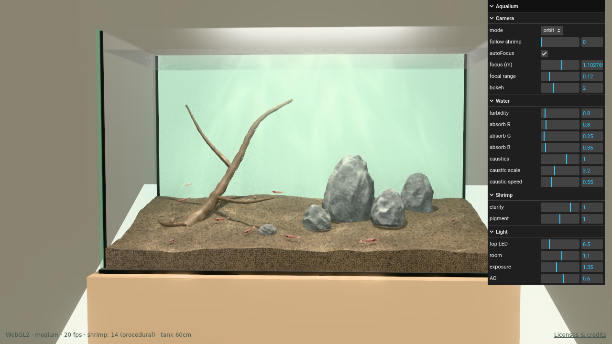

# Aquarium

A photorealistic freshwater shrimp (cherry shrimp, *Neocaridina davidi*) aquarium that runs in the browser, built with three.js `WebGPURenderer` and TSL. Falls back to WebGL2 when WebGPU is unavailable.



## Features

- **Water optics** — Beer–Lambert absorption and scattering along the view ray through the water volume, procedural caustics projected from the top light (with slight RGB dispersion), reflective glass and water surface.
- **Hardscape** — procedural soil, stones and driftwood (geometry and TSL materials), zero external assets required.
- **Cherry shrimp** — body segments lofted from the outline of a public-domain side photo, with the photo unrolled as a texture; translucent shell with transmission and Beer–Lambert body tint; rigid-segment rig, procedural animation and a simple behavior state machine.
- **Post-processing** — GTAO, bloom, TRAA and depth of field, switched by quality tier.
- **Replaceable model** — drop a glTF at `public/assets/shrimp/cherry.glb` to replace the procedural shrimp.

## Getting started

Requires Node.js 20.19+ (or 22.12+) and a browser with WebGPU (recent Chrome / Edge) or WebGL2.

```sh
npm install
npm run dev          # http://localhost:5173
npm run build        # type-check + production build into docs/
```

## GitHub Pages

Run `npm run build` and commit the generated files in `docs/` along with your changes, then push to `main`.

In the repository's **Settings → Pages**, select **Deploy from a branch**, branch **main**, and folder **/docs**. GitHub Pages publishes `docs/` directly whenever `main` is updated.

Build assets use relative URLs so they work under the repository's GitHub Pages path. Existing specifications and images in `docs/` are preserved during builds.

## URL parameters

| Parameter | Values | Description |
|---|---|---|
| `quality` | `high` (default) / `medium` / `low` | Shadow resolution, AO, DOF, bloom, particle count |
| `backend` | `webgl` | Force the WebGL2 backend |
| `shrimp` | number | Number of shrimp (default 14) |
| `post` | `off` | Disable post-processing |

The GUI in the top-right corner controls the camera (orbit / follow a shrimp), water turbidity and absorption, caustics and lighting.

## Custom shrimp model

Place a binary glTF at `public/assets/shrimp/cherry.glb` and it will be loaded automatically. See [docs/shrimp-model-spec.md](docs/shrimp-model-spec.md) for orientation, scale and joint naming requirements.

## Screenshot verification

```sh
npm run build && npx vite preview --port 5198 &
SHOT_QUERY="backend=webgl&quality=medium" CHROME_PATH=<chromium> npm run shot -- http://localhost:5198/ screenshots
```

## Project layout

| Path | Contents |
|---|---|
| `src/scene/` | Tank, lighting, hardscape placement |
| `src/materials/` | Water and hardscape TSL materials |
| `src/entities/shrimp/` | Shrimp geometry, materials, rig, animation and behavior |
| `src/post/` | Post-processing pipeline |
| `tools/shrimp-profile/` | Extracts the body profile and side texture from the reference photo |
| `scripts/` | Screenshot verification |
| `docs/` | Production build, implementation plan and model spec |

## Credits

- Reference photo of *Neocaridina heteropoda* by Pedro Doria Meunier, [Wikimedia Commons](https://commons.wikimedia.org/wiki/File:Neocaridina_heteropoda_female.png), public domain. See [assets-src/shrimp/SOURCE.md](assets-src/shrimp/SOURCE.md).
- three.js and its addons — MIT, copyright © 2010–2026 three.js authors.
- lil-gui — MIT, copyright © 2019 George Michael Brower.
- meshoptimizer / MeshoptDecoder — MIT, copyright © 2016–2026 Arseny Kapoulkine.
- MaterialX noise included in three.js — Apache-2.0, Academy Software Foundation project.
- Vite modulepreload polyfill — MIT, copyright © 2019–present VoidZero Inc. and Vite contributors.

Full license texts are included in [public/THIRD-PARTY-LICENSES.txt](public/THIRD-PARTY-LICENSES.txt) and copied into the published `docs/` directory. The site's **Licenses & credits** link opens these notices.

**Unresolved permission:** the caustic pattern in `src/materials/water.ts` identifies joltz0r / Dave_Hoskins as its source, but the original license has not been verified. Attribution alone does not establish permission to redistribute that implementation under MIT. See [docs/license-review.md](docs/license-review.md).

## License

Project code is licensed under [MIT](LICENSE). Third-party components retain their own licenses; the published site includes [THIRD-PARTY-LICENSES.txt](public/THIRD-PARTY-LICENSES.txt). See [the license review](docs/license-review.md) for asset provenance and the unresolved caustic shader permission.
